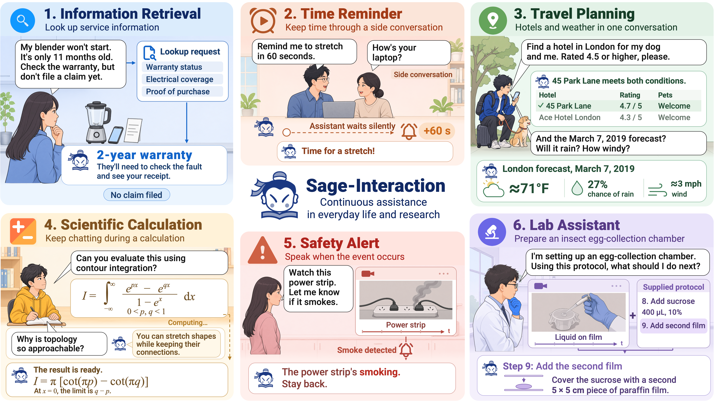
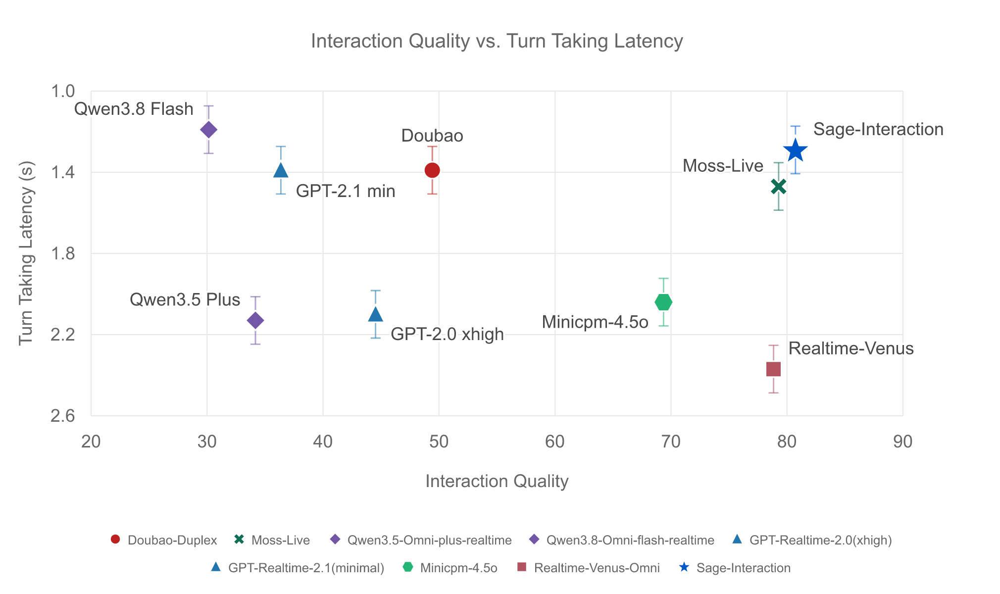
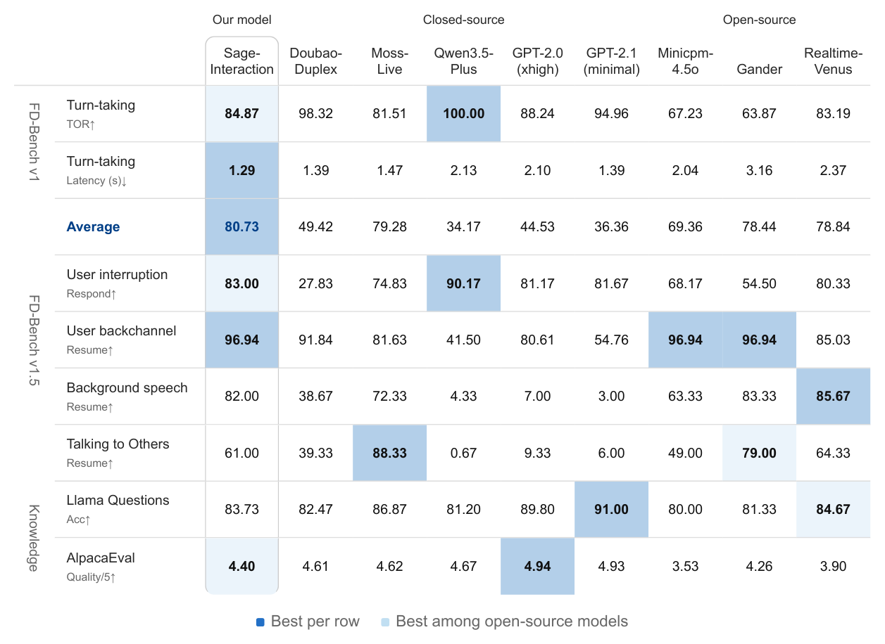
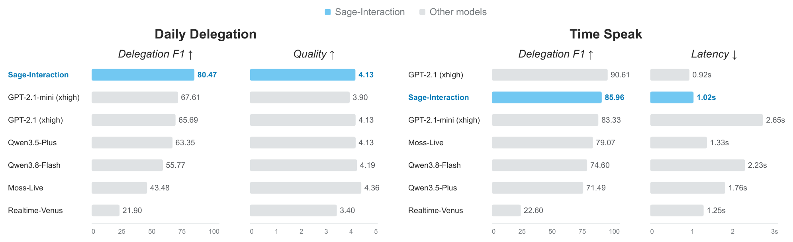
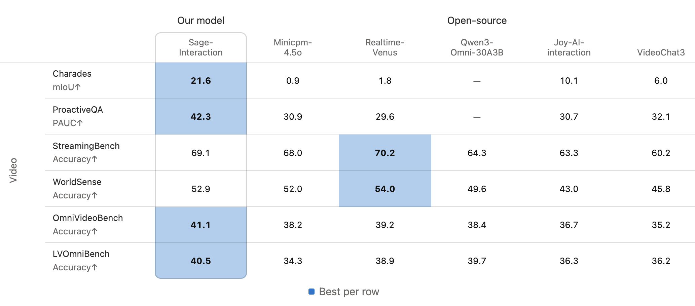

<div align="center">

# Sage-Interaction

**具备智能体任务委托能力的全模态交互模型**

<a href="assets/sage-overview.png">
  
</a>

全双工交互，异步任务执行。

[English](README.md) | [简体中文](README_zh-CN.md)

[项目主页](https://internlm.github.io/Sage-Interaction/) | [Hugging Face](https://huggingface.co/internlm/Sage-Interaction)

</div>

## 简介

**Sage-Interaction** 是基于 **MiniCPM-o 4.5** 训练的 **9B 参数全模态交互模型**，将**全双工交互**与**智能体任务委托（Agentic Task Delegation）**相结合。模型可以在持续与用户对话、处理传入音视频信息的同时，提交任务供后台异步执行，并在任务完成后将结果融入当前对话。

Sage-Interaction 运行于前台与后台协同的系统中：前台负责实时交互，持续关注用户和动态变化的视觉上下文；后台执行需要持续推理或工具调用的较长任务。通过连接持续的音视频交互与后台任务执行，模型支持日常辅助和科学工作流中面向任务的协作。

### 核心特性

- **全双工全模态交互。** 在生成回复的同时持续感知输入的音频与视频，并在用户打断、简短附和和背景语音等情况下保持对话连续。
- **智能体任务委托。** 识别适合委托的任务，提交后台异步执行，并将返回结果用于后续对话，在任务执行期间持续响应用户。
- **流式视频理解。** 理解动态变化的视觉上下文，对相关事件主动响应，并支持基于实时视频内容的任务委托。
- **真实场景驱动的交互训练。** 通过基于真实场景的角色扮演多智能体系统生成交互轨迹，并采用音视频非对称监督目标，兼顾较密集的音频信号与较稀疏的视频信号。

### 快速开始

安装与使用方法见 [Demo 使用说明](demo/README_zh-CN.md)。

## 性能评估

我们从全双工语音交互、任务委托和流式视频理解三个方面评估 Sage-Interaction。**↑** 表示越高越好，**↓** 表示越低越好；**—** 表示未提供对应结果。

### 全双工语音交互

Sage-Interaction 在 **FD-Bench v1.5 上的平均得分为 80.73**，在参与对比的开源和闭源模型中排名第一；在 **FD-Bench v1 上的轮次切换时延为 1.29 秒**。

<p align="center">
  
</p>

横轴为 FD-Bench v1.5 交互质量，纵轴为 FD-Bench v1 轮次切换时延。交互质量越高、时延越低，表现越好。

在 FD-Bench v1.5 中，Sage-Interaction 对用户打断的响应得分为 **83.00**，在用户简短附和后恢复对话的得分为 **96.94**；背景语音后的对话恢复得分为 **82.00**，用户与他人交谈场景的对话恢复得分为 **61.00**。

<p align="center">
  
</p>

### 任务委托与定时提醒

Sage-Interaction 在 **Daily Delegation 上取得 80.47 F1**，在参与对比的模型中排名第一，回答质量为 **4.13/5**。在 **Time Speak** 上，模型取得 **85.96 F1**，提醒时延为 **1.019 秒**。这两项评测分别考察日常交互中的任务委托和定时响应能力。

<p align="center">
  
</p>

### 流式视频理解与主动响应

Sage-Interaction 在 **Charades 上取得 21.6 mIoU**，在 **ProactiveQA 上取得 42.3 PAUC**，在这两项主动响应评测中均领先参与对比的模型。同时，模型在 **OmniVideoBench（41.1）** 和 **LVOmniBench（40.5）** 上取得该组对比的最优结果，在 StreamingBench 和 DailyOmni 上分别取得 **69.1** 和 **80.1**。

<p align="center">
  
</p>

## Demo

### 任务委托

https://github.com/user-attachments/assets/5c4da4f5-a9a6-40ce-aa26-0f734e18f8bc

## 致谢

本研究得到上海人工智能实验室的支持。

特别感谢 [MiniCPM-o 4.5](https://github.com/OpenBMB/MiniCPM-V)、[Qwen3-TTS](https://github.com/QwenLM/Qwen3-TTS)、[Qwen3-ASR](https://github.com/QwenLM/Qwen3-ASR)、[Whisper](https://github.com/openai/whisper)、[DeepSeek-V4.1-Flash](https://huggingface.co/deepseek-ai/DeepSeek-V4.1-Flash) 和 [JoyAI-VL-Interaction](https://github.com/jd-opensource/JoyAI-VL-Interaction) 等开源项目的开发者与维护者。他们分享的模型、工具及其他资源为本研究提供了重要支持。我们还要感谢支持 Sage-Interaction 模型及相关数据集开发工作的同事与合作者。

## 引用

```bibtex
@misc{sage_interaction,
  title = {Sage-Interaction: An Omni Interaction Model with Agentic Task Delegation},
  author= {Sage-Interaction Team},
  year = {2026},
  url = {https://github.com/InternLM/Sage-Interaction}
}
```
